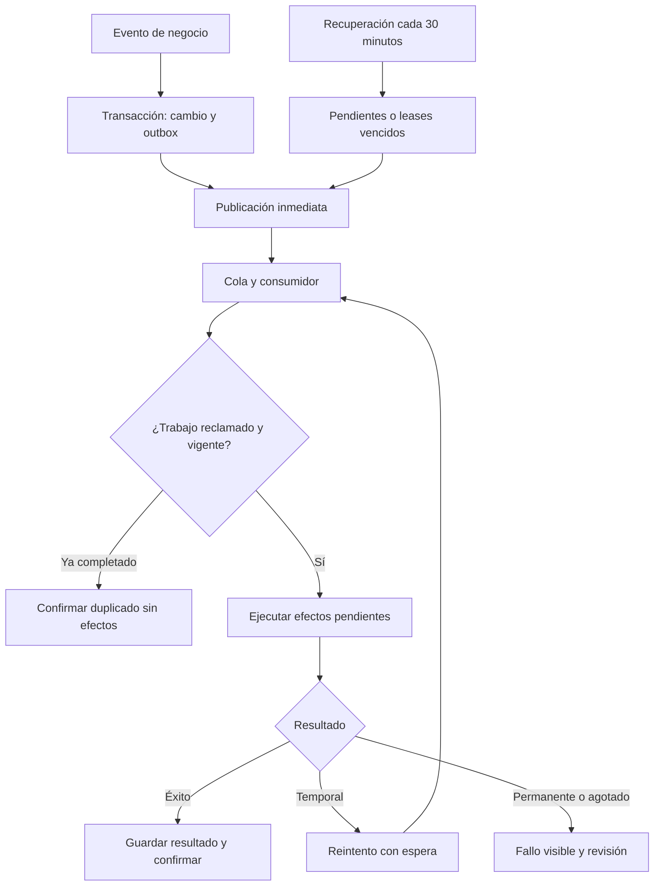

# Plan de colas, recuperación, idempotencia y seguridad

**Proyecto:** Cortés Rodríguez Asesores  
**Fecha:** 25 de octubre de 2026  
**Estado:** AUD27-01 a AUD27-04 implementados y probados localmente; commits publicados en `dev`. Pendientes despliegue y validación integrada de estas correcciones en dev, AUD27-05 a AUD27-09 y autorización de promoción a producción.
**Código de corrección vigente:** rama `dev`, commit `edb8e50d8a5544425d337524003c14541e3899fd`; documentación de implementación en `bf424c3f3a6b04b80d17f801cd54a46eb421b97e`. La revisión que originó las tareas se hizo sobre `35d1c82`. Las cifras y hallazgos anteriores conservan valor histórico; el estado actual se resume a continuación y en 19.13–19.14.

**Actualización:** medidas de seguridad contrastadas en `dev`; controles de infraestructura pendientes de evidencia se distinguen de faltantes de código.

**Avance 25-oct-2026:** SEC-01 a SEC-07 implementados localmente con pruebas unitarias. SEC-02 también revisó rutas generales y dashboard del experto; bandeja y métricas no muestran asignaciones impagas. SEC-06 incluye límites progresivos de inicio de sesión y límites por IP para emisión de tokens/solicitudes públicas; Turnstile obligatorio en producción sigue pendiente. SEC-08 incluye publicación inmediata, recuperación durable, efectos de correo idempotentes, leases con fencing tokens, vigencia de asignación validada en el consumidor, bitácora DLQ sin guardar payloads, redrive/reconciliación solo para administración y resultado incierto detenido como `uncertain`. SEC-12 añade descarga privada de adjuntos con autorización por rol/asignación y pago aprobado; los enlaces públicos de imágenes ya no exponen objetos `requests/`. SEC-13 hace que `npm run deploy` use dev y que el migrador operativo cargue exclusivamente `.env.dev`. **Solo dev:** migración 037 aplicada a Neon de `.env.dev`; creada la cola de respaldo de DLQ; Worker versión `40a2ab52-a370-42a5-8d2e-cc9708c1bc56` desplegada con cron `*/30`, consumidor principal y consumidor DLQ. Build exitoso, 23 suites pasan y smoke checks dev dieron landing `200` y `/images/requests/*` `404`. La lista de nombres de secretos dev fue revisada sin leer sus valores. **Verificación externa pendiente:** inyectar un fallo controlado en Cloudflare para demostrar ciclo cola/DLQ/redrive y confirmar permisos efectivos y aislamiento real Neon/R2/Queues/DO entre entornos. Prueba automatizada de recuperación de pendientes, leases vencidos, cola atascada y publicación fallida añadida; validación completa en dev sigue pendiente. Producción y `main` no se modifican ni despliegan.

**Revisión 26-oct-2026:** pendientes REV-01 a REV-08 documentados en la sección 18. Las marcas de implementación anteriores no cierran los defectos de pagos, notas, correo, confirmación de conversión ni atribución detectados en esta revisión.

**Ampliación funcional:** portal «Consultar mis solicitudes», acceso por correo y código, retorno de pasarela, seguimiento y reintentos sobre la misma solicitud (sección 17). Frecuencia de recuperación acordada: 30 minutos.


## Estado actual de ejecución

| Bloque | Implementación | Verificación actual | Siguiente paso |
|---|---|---|---|
| AUD27-01: autorización y reserva de cobro Bricks | Implementado en `edb8e50` | Pruebas locales, SQL en PostgreSQL embebido y ruta cancelada sin llamada de cobro | Desplegar corrección en dev y probar cancelación/recuperación/concurrencia en Neon y sandbox |
| AUD27-02: asociación y conciliación de intentos | Implementado en `edb8e50` | Casos locales de ID externo, metadata, identidad contradictoria, ambigüedad e indisponibilidad | Verificar pagos Pro históricos/nuevos y metadata en sandbox |
| AUD27-03: vuelta de Bricks a Pro | Implementado en `edb8e50` | Política de interfaz e invalidación SQL de intentos nunca enviados | Probar flag remoto, pestañas abiertas y estados de ambos métodos |
| AUD27-04: suite y regresiones | Completado localmente | **119/119**, sin fallos ni omitidas; build y `git diff --check` correctos | Mantener suite verde e incorporar evidencia de integración |
| AUD27-05: política de origen | Pendiente | Divergencia registrada entre requisito original y acceso directo actual | Registrar decisión y alinear plan, código y pruebas |
| AUD27-06: recorrido completo externo | Pendiente para las correcciones nuevas | El pago Bricks aprobado documentado es anterior a `edb8e50` | Ejecutar matriz 19.8 con correo real autorizado y pagos sandbox |
| AUD27-07: reportes y balance | Pendiente | Listado de pagos no sustituye los reportes del alcance | Implementar/controlar alcance financiero acordado |
| AUD27-08: excepciones administrativas | Pendiente de completar/verificar | Hay conciliación y gestión de colas parciales | Demostrar resolución auditada sin editar tablas |
| AUD27-09: preparación de producción | Pendiente | No hubo despliegue, migración ni cambio de flags/secretos en esta ejecución | Completar condiciones de salida y promoción autorizada |

**No confundir:** publicado en la rama `dev` no significa desplegado en el Worker dev, probado en servicios externos ni listo para producción.

## 1. Objetivo

Procesar tareas al ocurrir sus eventos, reducir consultas periódicas sin actividad y asegurar que los reintentos no dupliquen pagos registrados, asignaciones, correos, notificaciones ni estadísticas.

La primera entrega reutilizará Cloudflare Queues y la tabla de pendientes existentes. El job cada minuto dejará de ser el mecanismo principal y pasará a recuperar trabajo cada 30 minutos.

No se incorpora JEV. La confirmación del pago y la aprobación administrativa siguen siendo decisiones verificadas y persistidas por el servidor.

## 2. Arquitectura propuesta

1. Validar autorización, datos y condiciones del negocio.
2. Guardar el cambio y su evento en una misma transacción PostgreSQL: patrón transactional outbox.
3. Después del commit, intentar publicar el identificador del evento inmediatamente en la cola. No depender únicamente de una tarea en memoria o de `waitUntil` para garantizar la publicación.
4. El consumidor reclama el trabajo mediante una operación atómica, comprueba idempotencia y ejecuta los efectos pendientes.
5. Registrar el resultado de cada efecto, no solo un estado global del evento.
6. Confirmar el mensaje de cola cuando el trabajo terminó o su duplicación está resuelta. Los fallos temporales se reintentan.
7. El job de respaldo recupera publicaciones pendientes y trabajos con lease vencido.

La cola puede entregar mensajes más de una vez y fuera de orden. No se promete ejecución exactamente una vez de servicios externos: se combinan restricciones de base de datos, claves estables y conciliación para evitar duplicados y tratar resultados ambiguos.



## 3. Cambio del job programado

Actualizar `wrangler.dev.jsonc` y `wrangler.jsonc`, primero en desarrollo:

```json
{
  "triggers": {
    "crons": ["*/30 * * * *"]
  }
}
```

| Medida | Cada minuto | Cada 30 minutos |
|---|---:|---:|
| Activaciones diarias por entorno | 1.440 | 48 |
| Activaciones en 30 días por entorno | 43.200 | 1.440 |
| Dos entornos durante 30 días | 86.400 | 2.880 |

Reducción de activaciones programadas respecto a cada minuto: **96,7 %**. Sí reduce ejecuciones y consumo del respaldo; el ahorro en factura depende del consumo facturable y las capas gratuitas. Frente a cada 15 minutos, reduce las activaciones a la mitad. Medir actividad de Neon, consultas, CPU y operaciones de cola.

La frecuencia acordada es de 30 minutos únicamente como recuperación: el flujo normal publica y procesa inmediatamente. Una publicación perdida puede esperar hasta el siguiente ciclo (cerca de 30 minutos en el peor momento), más el tiempo de procesamiento. Un lease vencido espera el siguiente ciclo elegible. No es una garantía de recuperación si persiste la falla. No reducir la frecuencia antes de probar publicación inmediata, consumidores, alertas e idempotencia.

La recuperación de 30 minutos es un barrido de respaldo, no un SLA para eventos normales. Inventariar cada ruta que crea outbox (incluidos pagos, asignaciones, revisiones, respuestas y notificaciones manuales) y demostrar que todas publican al confirmar su transacción. El barrido debe recuperar también eventos que quedaron `queued`/publicados sin progreso y leases vencidos, con límites y alertas; no basta con seleccionar filas `pending`.

### Responsabilidades del recuperador

- Seleccionar por lotes eventos pendientes cuya fecha de publicación llegó.
- Reclamar filas con `FOR UPDATE SKIP LOCKED` o actualización condicional equivalente.
- Recuperar leases vencidos de publicación y procesamiento.
- Detectar eventos publicados sin progreso después de un plazo configurable, coordinado con los reintentos de la cola.
- Respetar `next_attempt_at`, número de intentos y presupuesto de trabajo por ejecución.
- No volver a procesar completados ni resucitar fallos definitivos o DLQ automáticamente.
- Usar índices sobre estado y fecha para evitar recorrer toda la tabla.

Un fallo al publicar debe dejar el evento recuperable. Si la cola aceptó el mensaje pero el productor no pudo registrar ese éxito, una publicación duplicada es admisible: el consumidor debe neutralizarla.

## 4. Procesos y prioridades

| Prioridad | Proceso | Beneficio y condiciones |
|---|---|---|
| P0 | Publicación de notificaciones | Evitar la espera del cron y conservar eventos ante caídas |
| P0 | Efectos posteriores al pago | Asignación y avisos recuperables sin repetir el pago |
| P0 | Entrega de respuesta aprobada | Enviar exactamente la versión aprobada y su nota |
| P1 | Imágenes | Optimización, eliminación de metadatos y miniaturas |
| P1 | Reportes descargables | Evitar peticiones largas y permitir descargas posteriores |
| P2 | Estadísticas | Resúmenes incrementales y conciliación con datos originales |
| P2 | Limpieza | Retirar temporales y huérfanos mediante lotes seguros |

Separar consumidores o colas de notificaciones, medios y reportes cuando sea necesario para que una exportación pesada no retrase un correo. La disponibilidad y costo de cada servicio se verificará antes de habilitarlo.

## 5. Idempotencia de extremo a extremo

### 5.1 API de solicitudes

- El navegador genera una clave por envío lógico y la conserva al reintentar.
- El servidor calcula un hash canónico del contenido e identidad de adjuntos relevantes.
- Una restricción única impide crear dos solicitudes con la misma clave dentro de su ámbito.
- Misma clave y mismo contenido: devolver la solicitud y resultado existentes.
- Misma clave y distinto contenido: rechazar con conflicto `409`.
- Un envío nuevo e intencional utiliza otra clave.
- La identidad del cliente se resuelve de forma consistente; no crear clientes duplicados por reintentos concurrentes.

### 5.2 Eventos y efectos

Claves ilustrativas, adaptables al modelo existente:

| Acción | Clave estable propuesta |
|---|---|
| Confirmación del proveedor | `payment/{provider}/{provider_payment_id}/approved` |
| Activar atención tras el primer pago | `request/{request_id}/payment_satisfied` |
| Asignación inicial | `assignment/{request_id}/initial` |
| Reasignación autorizada | `assignment/{request_id}/revision/{revision}` |
| Aprobación de respuesta | `response/{response_id}/approved/{approval_revision}` |
| Correo | `email/{event_id}/{recipient_id}/{template_version}` |
| Notificación interna | `app/{event_id}/{user_id}` |
| Imagen derivada | `image/{attachment_id}/{source_hash}/{transform_version}` |
| Actualización de métricas | `metric/{event_id}/{projection_name}/{projection_version}` |
| Reporte | `report/{job_id}` |
| Eliminación de archivo | `delete/{object_key}/{object_version}` |

No usar un UUID nuevo en cada reintento del mismo evento. Un reenvío manual intencional crea una nueva revisión o evento explícito y deja auditoría; no borra el historial de deduplicación.

### 5.3 Restricciones y concurrencia

Proponer, tras revisar el esquema existente:

- `UNIQUE(event_key)` en outbox.
- `UNIQUE(event_id, effect_key)` en el registro de efectos.
- Clave única del pago por proveedor e identificador externo.
- Restricción o compare-and-swap para asignación inicial.
- Restricción única de notificación interna por evento y usuario.
- Actualización de aprobación condicionada a `status = 'pending_admin_review'` y a la versión esperada.

Reclamar trabajos con `lease_owner`, `lease_expires_at` y un identificador de intento. Las escrituras de finalización exigirán que el consumidor siga siendo dueño del lease. Un trabajador antiguo no debe sobrescribir a otro que recuperó la tarea.

Si el lease está ocupado, no ejecutar el efecto: diferir el mensaje o reconocer únicamente una copia redundante cuando el trabajo durable y su recuperación estén asegurados. Mantener la transacción de reclamación corta; no sostener bloqueos durante llamadas externas.

### 5.4 Correos y resultados ambiguos

- Enviar un correo separado por destinatario para no exponer identidades entre cliente, agente y experto.
- Persistir destinatario, plantilla, versión de respuesta y contenido autorizado necesarios para reproducir el envío.
- Usar la misma clave de idempotencia del proveedor en cada reintento del mismo correo, dentro de su vigencia documentada.
- Registrar el identificador devuelto por Resend y deduplicar sus webhooks.
- Si Resend aceptó el correo pero se perdió la respuesta o falló la escritura local, marcar el resultado como incierto y conciliar antes de reenviar fuera de la ventana de deduplicación del proveedor.
- Definir la decisión al vencer la ventana de idempotencia de Resend: mantener el efecto en estado `uncertain`, consultar eventos/registro de Resend y requerir decisión administrativa auditada si no se puede demostrar aceptación o rechazo. Nunca cambiar la clave ni reenviar automáticamente un correo incierto tras esa ventana.
- Distinguir `accepted`, `delivered`, `bounced` y `failed`. No afirmar entrega ni lectura por una respuesta HTTP exitosa.

La base local por sí sola no puede garantizar ausencia absoluta de correos duplicados si el servicio externo aceptó la operación y se perdió toda confirmación.

Definir una matriz de efectos por evento y audiencia antes de cablear consumidores: destinatario identificado, plantilla/versionado, datos permitidos, condición de pago/asignación, clave idempotente y política de reintento. Incluir correo cliente, experto asignado, agente y administración por separado; las notificaciones de campana son efectos separados y pueden tener destinatarios distintos.

### 5.5 Retención y orden

Conservar claves y resultados durante un plazo superior a los reintentos, redrives y recuperaciones admitidos. Las claves financieras requieren una política acorde con la trazabilidad del negocio, no una limpieza rápida genérica.

Los eventos llevarán una versión de entidad. Antes de aplicar una transición, verificar el estado actual y descartar eventos obsoletos. No permitir que un evento tardío de pago pendiente sustituya uno aprobado ni que una asignación antigua revierta una reasignación.

## 6. Pago y habilitación de atención

1. Validar firma del webhook y consultar el pago con la pasarela según el mecanismo existente.
2. Comprobar referencia, importe, moneda y vinculación al comercio aplicables.
3. En una transacción, registrar el resultado del proveedor, aplicar la transición autorizada y crear el evento de pago satisfecho una sola vez.
4. Responder al cliente con el pago confirmado cuando ya esté persistido.
5. Publicar el evento inmediatamente.
6. El consumidor aplica la asignación inicial una sola vez y crea sus efectos de notificación.
7. Si no hay experto disponible, registrar cola administrativa y avisar después del pago confirmado.

El experto solo puede consultar y responder si está asignado y el pago está aprobado o existe una exención administrativa válida. No basta con ocultar la solicitud en el frontend.

Dos pagos distintos aprobados para la misma solicitud no deben descartarse como un duplicado técnico: registrar ambos y generar una alerta financiera, evitando activar dos veces la atención. Reembolsos y contracargos son eventos diferentes, sujetos a reglas propias.

## 7. Aprobación y entrega

- El administrador aprueba una versión concreta, con nota pública opcional.
- La transición de revisión y su evento de entrega se guardan en la misma transacción.
- El consumidor envía esa versión; no consulta un borrador mutable como fuente del contenido.
- Separar estado de atención del estado de entrega: una respuesta aprobada puede tener entrega pendiente o fallida.
- Dos aprobaciones concurrentes no deben producir dos aprobaciones efectivas ni envíos dobles.
- Un correo fallido se reintenta sin reabrir el caso ni modificar la respuesta.
- Observaciones internas y nota pública permanecen separadas.

## 8. Imágenes

- Validar formato real, tamaño, límites y autorización antes de aceptar la carga.
- Registrar original en almacenamiento privado con estado `pending_processing`.
- Seleccionar un procesador compatible; estimar su costo antes de incorporarlo.
- Generar derivados en rutas deterministas basadas en hash y versión de transformación.
- Marcar disponibilidad solo cuando el derivado y su referencia estén guardados.
- Si el objeto ya existe con la versión esperada, reutilizarlo al reintentar.
- La descarga valida asignación y permisos. Quitar metadatos no anonimiza texto o caras visibles: mantener revisión de privacidad.
- Definir retención del original y limpieza de cargas incompletas con plazo de gracia.

## 9. Reportes y estadísticas

### Reportes

Guardar solicitante, filtros, alcance autorizado y fecha de corte. El trabajo retorna un identificador inmediatamente; luego ofrece una descarga autenticada o de vigencia limitada.

Una fecha de corte por sí sola no congela filas editables: definir si el reporte será orientativo con datos consultados al ejecutarlo o reproducible mediante instantánea, versionado o registro contable inmutable. Los balances financieros deben usar la opción reproducible.

Reutilizar un reporte completado del mismo trabajo. Las exportaciones no deben incluir datos de clientes a usuarios sin permiso, aunque los filtros o identificadores sean manipulados.

### Estadísticas

Aplicar cada evento una vez por proyección. Registrar deduplicación y actualización del agregado en una transacción. Emplear importes enteros en unidades menores y separar monedas; no sumar USD y COP directamente.

Mantener pagos y movimientos como fuente de verdad y una rutina de conciliación para reconstruir totales. Contemplar reembolsos y correcciones con eventos compensatorios.

## 10. Limpieza segura

- Marcar candidatos, aplicar plazo de gracia y volver a comprobar que no tienen referencias activas antes de eliminar.
- Usar identificador y versión de objeto para no borrar un archivo reemplazado.
- Eliminar un archivo ya ausente se considera éxito idempotente.
- No borrar originales necesarios para auditoría ni registros financieros mediante limpieza genérica.
- Usar lotes pequeños y registro del resultado. La búsqueda de candidatos puede tener su propio horario menos frecuente; las colas ejecutan los lotes.

## 11. Reintentos, DLQ y observabilidad

- Clasificar fallos: transitorios, permanentes y resultado externo incierto.
- Aplicar espera progresiva con variación aleatoria y respetar límites del proveedor.
- Definir un presupuesto total de intentos para evitar multiplicar reintentos de aplicación, cola y recuperador.
- Al agotar el presupuesto, enviar a DLQ o estado fallido y alertar al administrador.
- El redrive conserva las claves de efecto; exige causa corregida, permisos y auditoría.
- No confirmar un mensaje antes de persistir su resultado durable.
- Configurar concurrencia por tipo de tarea para no saturar Neon o Resend.

Métricas: tiempo evento-publicación, tiempo hasta primer procesamiento, duración de cada efecto, antigüedad del pendiente más viejo, reintentos, duplicados neutralizados, leases vencidos, DLQ, consultas y horas activas de Neon, operaciones/CPU de Workers, almacenamiento y operaciones R2.

Alertar por umbrales configurables y por ausencia de consumidores; reducir el cron sin garantizar que el consumidor funciona puede aumentar la demora de recuperación.

## 12. Plan de implementación

**Cierre de la entrega:** ejecutar en coordinación con la secuencia actualizada de 19.12. Las fases/checks históricos no sustituyen las correcciones AUD27 ni la validación de salida a producción.

### Fase 0: cerrar brechas de seguridad P0 — parcialmente implementada; requiere verificación externa

- [x] SEC-01: sesión y permisos vigentes; revocación al desactivar cuenta.
- [x] SEC-02: experto limitado por asignación y pago; revisar rutas alternas y dashboard.
- [x] SEC-03 a SEC-05: aislamiento de correos, atribución pública y revisión condicional/atómica.
- [ ] Hacer obligatorio Turnstile en producción y completar SEC-12 antes de cualquier promoción; producción permanece sin cambios.
- [ ] Conservar los controles existentes y ejecutar pruebas de acceso denegado con usuarios de cada rol.
- [ ] Registrar evidencia de configuración de secretos y aislamiento de entornos; resolver faltantes críticos encontrados en SEC-13.

### Fase 1: consolidar contratos y migraciones — parcial

- [x] Revisar esquema, colas y cambios concurrentes del plan; agregar migraciones 032–036 para atribución, notas internas, límites y registro idempotente de correos.
- [x] Aplicar en orden migraciones 032–036 a Neon dev y comprobar ejecución satisfactoria.
- [x] Reutilizar outbox; migración 037 aplicada en Neon dev para fencing tokens y registro durable de fallos.
- [ ] Identificar duplicados existentes antes de aplicar índices únicos.
- [ ] Definir estados, claves, orden y retención.
- [x] Corregir accesos de experto antes de habilitar efectos de pago.

### Fase 2: publicación inmediata y consumidores — desplegada en dev; falta verificación controlada

- [ ] Guardar todas las transiciones y eventos en una transacción o sentencia atómica; aprobación/rechazo, reasignación manual y resolución de similitud ya usan sentencia única; revisar creación pública, pago y productores restantes.
- [x] Publicar inmediatamente desde los productores de outbox que tienen acceso al binding de cola.
- [x] Validar forma del ID y contrato básico del outbox antes de efectos; aislar entrega de correo por destinatario.
- [x] Alinear la clave del evento de asignación inicial con la clave creada por el trigger; quitar ventana de 24 horas que dejaba eventos pendientes sin recuperación.
- [x] Registrar cada correo por efecto/destinatario, conservar la huella y clave (sin almacenar el cuerpo completo); omitir destinatarios aceptados y bloquear reenvíos automáticos de resultado incierto tras 24 horas.
- [x] Persistir estados inciertos y aceptación por destinatario en `notification_email_effects` (migración 036).
- [x] Implementar reclamación, leases e idempotencia local por efecto/destinatario.
- [x] Materializar notificaciones internas desde el consumidor con destinatarios por rol.
- [x] Separar envíos por destinatario y eliminar identidad del cliente de correos a expertos.
- [x] Registrar envíos inciertos y conciliarlos solo con evidencia de Resend o confirmación administrativa auditada.
- [x] Validar contratos y asignación experta vigente al consumir eventos; cancelar eventos de asignaciones sustituidas y dirigir avisos al experto específico (SEC-08).
- [x] Fencing tokens en leases de publicación, procesamiento y efectos Resend para impedir que un trabajador vencido sobrescriba el resultado de otro.
- [x] Persistir identificador/hash/tipo/intent de mensajes inválidos y DLQ sin guardar el payload; redrive e ignorado administrativo con justificación y auditoría.
- [x] Conciliar efectos Resend inciertos: registrar aceptación con ID de Resend o reintentar solo tras confirmación administrativa de no aceptación; el redrive bloquea efectos inciertos no conciliados.
- [x] Aplicar migración 037 y desplegar los dos consumidores de dev; Cloudflare muestra un consumidor en la cola principal y otro en la DLQ.
- [ ] Verificar flujo real de cola, persistencia DLQ y redrive con un evento de prueba controlado en Cloudflare dev.
- [x] Revalidar sesión y snapshot de permisos en conexiones WebSocket; alarma de respaldo de 60 segundos (SEC-07).

### Fase 3: recuperación cada 30 minutos — desplegada en dev; falta prueba de recuperación

- [ ] Probar fallos de publicación y expiración de leases.
- [ ] Confirmar recuperación del outbox histórico sin repetir completados.
- [ ] Cambiar cron en desarrollo a `*/30 * * * *`.
- [x] Configurar `*/30 * * * *` en `wrangler.dev.jsonc` y desplegarlo; el envío normal sigue siendo inmediato.
- [x] Añadir prueba automatizada de recuperación de pendientes, leases vencidos, eventos `queued` atascados y publicación fallida con fencing.
- [ ] Probar recuperación de un evento controlado y medir latencia del ciclo en Cloudflare dev.
- [ ] Verificar backlog, DLQ y latencia antes de cualquier cambio de entorno. No tocar configuración de producción.
- [ ] No promover a producción ni integrar en `main` dentro de este trabajo; cualquier cambio futuro de alcance requerirá instrucción expresa.

### Fase 4: portal del cliente y recuperación de pagos — en curso

- [x] Agregar «Consultar mis solicitudes» en la landing, el formulario público, la confirmación de solicitud y el retorno de pago.
- [x] Reutilizar en el portal el acceso passwordless existente por código de correo, con listado paginado limitado al correo autenticado.
- [x] Añadir detalle de solicitud con respuestas aprobadas, adjuntos privados y estados independientes de pago y atención.
- [x] Añadir al portal acciones para iniciar/reanudar checkout y consultar el historial de intentos sin crear otra solicitud.
- [x] Registrar primero el intento local y serializar la creación de preferencias por solicitud; bloquear un nuevo cobro mientras el estado sea incierto.
- [x] Evitar registrar dos intentos como aprobados para la misma solicitud; dejar un segundo pago aprobado en estado `duplicate_approved` y diagnóstico para revisión administrativa.
- [x] Limitar de forma atómica la solicitud de códigos por correo; serializar envíos y conservar el código anterior si Resend falla.
- [x] Reservar cada intento de validación del código bajo bloqueo de fila; el quinto intento fallido consume el código.
- [x] Aplicar migraciones 038, 039 y 040 en la base operativa dev.
- [x] Desplegar el portal en Worker dev; página del portal 200, APIs de sesión/listado sin autenticar 401 y feature flags 200.
- [ ] Completar conciliación administrativa para intentos de preferencia cuyo resultado sea incierto.
- [ ] Publicar acceso al portal en los correos de pago y de respuesta que correspondan.
- [x] Agregar pruebas de sesión, titularidad, respuestas visibles, intentos de código concurrentes y fallo de Resend.
- [x] Ejecutar suite automatizada (24 archivos de pruebas), build y `git diff --check`.
- [ ] Ejecutar pruebas integradas autenticadas en dev con Mercado Pago sandbox; confirmar doble clic, retorno y conciliación.

**Estado publicado (2026-10-25):** commit `3a8da30` en `origin/dev`; Worker dev versión `2988635d-5844-4e94-98a0-fe5cd83fb6a5`. Se comprobó `/portal-cliente` (200), `/api/client/session` sin sesión (401), `/api/client/requests` sin sesión (401) y `/api/public/features` (200). La prueba de APIs protegidas no sustituye el acceso con correo real ni el checkout sandbox.

### Fase 5: imágenes y reportes

- [ ] Seleccionar y presupuestar procesador de imágenes.
- [ ] Implementar derivados privados con claves deterministas.
- [ ] Completar descarga autorizada y estados de procesamiento.
- [ ] Incorporar trabajos de exportación y descargas seguras.
- [ ] Completar controles de imágenes, descarga y exportación de SEC-09 y SEC-10.

### Fase 6: estadísticas y limpieza

- [ ] Proyecciones idempotentes con conciliación.
- [ ] Limpieza por lotes con verificación de referencias y plazo de gracia.
- [ ] Medir costos antes y después con carga comparable.
- [ ] Completar auditoría, alertas y prueba de restauración (SEC-14 y SEC-15).
- [ ] Verificar cabeceras y protecciones del navegador (SEC-16).

El portal del cliente se adelanta a imágenes, exportaciones y proyecciones: ofrece valor directo y ya cuenta con una base funcional. Se mantiene como entrega independiente, después de cerrar los controles P0 y la confiabilidad de eventos/pagos.

## 13. Pruebas de aceptación

| Escenario | Resultado esperado |
|---|---|
| Reenvío del formulario con misma clave y contenido | Una solicitud; mismo resultado |
| Misma clave con contenido diferente | Conflicto, sin duplicar datos |
| Caída después del commit y antes de publicar | El recuperador publica el evento |
| Publicación duplicada o consumidores simultáneos | Un efecto de negocio por clave |
| Caída del consumidor y lease vencido | Otro intento recupera; el anterior no sobrescribe |
| Webhook aprobado repetido | Un registro del mismo pago y una activación |
| Dos pagos externos distintos para un caso | Ambos registrados; alerta y una activación |
| Evento viejo posterior a uno nuevo | No retrocede el estado |
| Experto intenta atender sin pago | Acceso o acción rechazados por backend |
| Dos administradores aprueban a la vez | Una transición y un evento efectivo |
| Resend acepta y se pierde la respuesta | Conciliación; no reenvío ciego |
| Correo del experto | Sin email del cliente en cuerpo, cabeceras o destinatarios visibles |
| Transformación de imagen repetida | Mismos derivados sin nuevas copias innecesarias |
| Exportación consultada por otro usuario | Acceso denegado |
| Evento estadístico duplicado | Total sin incremento duplicado |
| Archivo candidato vuelve a estar referenciado | No se elimina |
| Fallo permanente | Fallo visible sin ciclo infinito |
| Cola inactiva con cron de respaldo | Pendientes durables; alerta por demora |

## 14. Despliegue y reversión

Aplicar migraciones compatibles primero y habilitar publicación inmediata por configuración. Mantener un único mecanismo de reclamación, compartido por cron y consumidor, para evitar competencia insegura.

No publicar masivamente el histórico sin revisar sus estados. Los eventos antiguos no deben disparar correos inesperados. Permitir drenar el trabajo en curso y revisar la DLQ antes de retirar mecanismos anteriores.

Si aparece una falla, restaurar temporalmente el cron de un minuto manteniendo las mismas claves y leases. Revertir frecuencia no debe borrar eventos, efectos ni historial. La reversión de código requiere compatibilidad con las migraciones.

## 15. Resultado esperado

Notificaciones sin esperar al cron en condiciones normales; recuperación de trabajo durable; menos consultas periódicas vacías; efectos trazables sin duplicación por reintentos; imágenes y reportes procesados sin bloquear al usuario. El ahorro económico se validará con métricas, no únicamente con el número de activaciones programadas.

## 16. Medidas de seguridad pendientes

### 16.1 Alcance y clasificación

Revisión estática sobre `dev`, commit `8f975ed3d8399b24a770c10d070cd2d9a38e2881`, confirmado de nuevo al actualizar este documento. No se inspeccionaron paneles de proveedores, secretos, permisos efectivos de cuentas, reglas WAF ni copias de seguridad en producción. No es una certificación ni una prueba de penetración.

- **Faltante confirmado:** ausencia o comportamiento contrario comprobado en el flujo revisado.
- **Parcial:** existe una base y se especifica únicamente lo necesario para completarla.
- **Por verificar:** depende de configuración externa o de un recorrido aún no comprobado. Obtener evidencia antes de crear trabajo de implementación; no asumir que falta.
- **P0:** corregir antes de promover la nueva arquitectura a producción. **P1:** completar en la fase indicada antes de habilitar la funcionalidad afectada. Los P0 de seguridad complementan las prioridades de procesamiento de la sección 4.

### 16.2 Controles existentes que se conservan

Estos controles no se presupuestan como desarrollos desde cero. Su presencia en código no acredita configuración correcta en producción.

| Control observado | Evidencia y límite |
|---|---|
| Validación de webhook de Mercado Pago | `publicRequests.js`: HMAC, consulta al proveedor, comparación de referencia, preferencia cuando viene informada, monto COP y estado aprobado. Conservar y probar. |
| Precios calculados en servidor | Catálogo y conversión a COP consultados por backend. No confiar en precios recibidos del navegador. |
| Idempotencia del formulario | Clave UUID, hash del contenido y adjuntos y tratamiento de duplicados; extender a efectos según sección 5. |
| Restricciones de imágenes | Máximo 5, 10 MB por archivo y 25 MB total; inspección de bytes y dimensiones. Completar protección de carga y privacidad. |
| Turnstile | Validación servidor si existe `TURNSTILE_SECRET_KEY`; falta garantizar su obligatoriedad en producción. |
| Portal de clientes | Código de un uso, vencimiento de 10 minutos, límite atómico de 5 intentos, 4 solicitudes por correo/15 min y 12 por IP/15 min; IP almacenada como HMAC; cookie `HttpOnly; Secure; SameSite=Lax`; sesiones revocables. Ver despliegue dev del 2026-10-25. |
| Canal WebSocket | Ticket de un uso de 90 segundos, control de origen y sesión activa al conectar; falta revocar conexiones ya abiertas. |
| Restricción de agentes | `operationsData.js`: rechaza creación de solicitudes por agente sin rol admin y filtra solicitudes por vínculo; conservar y probar rutas alternativas. |
| Roles y auditoría | Existen permisos y tabla de auditoría; completar aplicación uniforme y cobertura de eventos sensibles. |

### 16.3 Brechas comprobadas y trabajo por completar

| ID / prioridad | Estado y evidencia | Acción pendiente | Criterio de aceptación |
|---|---|---|---|
| SEC-01 / P0 | Implementado localmente. `requireOperationsAuth` valida sesión no revocada, usuario activo y roles/permisos actuales; `/session` comparte la validación; desactivación revoca sesiones. Pruebas comprueban sesión revocada y permiso retirado. | Completar caso de usuario inactivo en prueba E2E. Si se incorpora cambio/reset de contraseña, revocar sesiones en ese flujo también. | Token revocado/usuario inactivo es rechazado; retirar permiso impide usarlo sin esperar expiración; desactivación invalida sesiones. |
| SEC-02 / P0 | Implementado localmente. `operationsExpert.js` filtra bandeja y `operationsData.js` limita el dashboard por pago aprobado cuando se requiere; el detalle general queda restringido a admin/agente creador, no a experto. Responder exige permiso `expert_responses.create`, asignación vigente, pago y solicitud abierta. Pruebas cubren bandeja, dashboard, permiso obsoleto e impago. | Validar el flujo de adjuntos privados al completar SEC-09. No existe una exención administrativa explícita en el esquema; no habilitar excepciones implícitas. | Experto con solo lectura no responde; impago no aparece en bandeja/dashboard ni se responde por ID; solicitud sin pago no habilita respuesta. |
| SEC-03 / P0 | Implementado localmente. `operationsEmail.js` envía un correo por destinatario; la audiencia del experto recibe contenido fijo y mínimo, sin identidad/datos del cliente, reply-to ni destinatarios compartidos. Clave Resend estable por evento, versión y hash del destinatario. | Mantener esta allowlist al añadir eventos y confirmar configuración de reglas con pruebas. | Correo del experto no expone datos del cliente ni audiencias cruzadas incluso con reglas configuradas incorrectamente. |
| SEC-04 / P0 | Desplegado en dev. `publicRequests.js` exige token opaco y válido; se guarda hash, audiencia, vencimiento y revocación; atribución de agente se resuelve en backend. Smoke checks dev: landing, configuración Turnstile y emisión de token respondieron 200. Se mantiene el feature flag de Cloudflare. | Completar pruebas funcionales con formulario/enlace de agente en dev; no confiar en `agentId` del navegador. | Token ausente, manipulado, expirado o revocado bloquea la creación; landing y enlace de agente válidos mantienen atribución. |
| SEC-05 / P0 | Implementado localmente. Transición condicional; aprobación, evento outbox y cierre se escriben en una sentencia, con versión aprobada y nota pública separada de la interna. Rechazo también usa transición condicional. | Validar concurrencia real contra PostgreSQL de desarrollo y verificar el consumidor de la versión aprobada. | Dos administradores simultáneos: una aprobación efectiva; otro recibe conflicto; fallo de escritura no deja caso cerrado sin evento durable. |
| SEC-06 / P0 | Implementado y desplegado en dev. Login operativo registra fallos con contadores atómicos por cuenta/IP y espera progresiva; formulario público limita tokens/solicitudes por IP; portal limita códigos atómicamente por correo e IP hasheada. Migraciones 034–035 y 038–040 aplicadas en dev. | Probar límites funcionales y recuperación en dev; evaluar límite de frecuencia para creación de preferencias de pago. Hacer obligatorio Turnstile en producción, validar integración y fallar de forma cerrada si no está configurado. | Ataques paralelos no eluden límites; respuesta controlada y recuperación; producción no acepta solicitudes sin Turnstile. |
| SEC-07 / P1 | Implementado localmente. `NotificationHub.js` asocia el socket al usuario, hash de sesión y snapshot de permisos; valida sesión/usuario/permisos al publicar y cada 60 s mediante alarma. | Probar logout, desactivación, expiración y cambio de rol en Cloudflare; revisar la política fail-closed ante indisponibilidad temporal de Neon. | Socket deja de recibir eventos tras revocación; la alarma cierra conexiones inválidas en un máximo aproximado de 60 s; no hay suscripción entre usuarios. |
| SEC-08 / P1 | Desplegado en dev: leases con fencing, validación del contrato y asignación vigente en consumidor, destinatario experto específico, DLQ persistida sin payload, redrive/ignorado administrativo auditado y conciliación de efectos inciertos. Migración 037 aplicada; prueba local de recuperación agregada. | Ejecutar prueba real de cola, envíos parciales, DLQ/redrive y recuperación en Cloudflare dev. Revisar atomicidad de productores restantes. | Redrive exige permiso y motivo; asignación sustituida no recibe el evento; efectos completados no se repiten; evidencia de prueba Cloudflare dev. |
| SEC-09 / P1 | El listado público de imágenes permite solo `gallery/`; adjuntos de solicitudes tienen endpoint privado con sesión, permiso, asignación y pago aprobado. | Desplegar en dev y completar revisión de tamaños, decodificación y metadatos de las imágenes. | URL pública o ID de adjunto ajeno no entrega archivos; experto asignado con pago aprobado sí los descarga. |
| SEC-10 / P1 | Funcionalidad nueva del plan: reportes asincrónicos. | Autorizar al solicitar, ejecutar y descargar; revalidar usuario y alcance si cambian permisos. Aislar objetos por trabajo/propietario, caducar descargas y neutralizar fórmulas en CSV/hojas exportadas. | ID o enlace de otro usuario no permite descarga; revocación impide acceso; valores como `=...` no se ejecutan como fórmulas. |
| SEC-11 / P1 | Faltante en login operativo revisado: no hay segundo factor. Estado en proveedores por verificar. | Agregar MFA para administradores y acciones críticas, con recuperación segura y auditada. Revisar primero si una solución de identidad existente lo cubre. Activar/verificar MFA de cuentas GitHub, Cloudflare, Neon, R2/Resend y pasarela según disponibilidad. | Cuenta administrativa requiere segundo factor; recuperación no lo evita sin control; cuentas técnicas tienen evidencia de protección equivalente. |
| SEC-12 / P0 | Parcial. Listados de clientes/pagos limitados por rol y adjuntos privados por autorización de admin o experto asignado con pago aprobado. | Desplegar y probar matriz de rol/recurso e IDs manipulados en detalle, asignación, respuesta y pago contra Neon dev. | IDs ajenos no revelan datos; agente ve su alcance; experto solo casos asignados y pagados; administración de cola es admin-only. |

Los tokens públicos de origen sirven para atribución y control de entrada; no son credenciales privadas y pueden compartirse. Turnstile y límites de abuso siguen siendo necesarios. Para consumidores, separar efectos ya comprometidos e inmutables de permisos que deben revalidarse: una baja o reasignación debe cancelar el envío pendiente al destinatario que ya no está autorizado y dejar auditoría de la decisión.

### 16.4 Controles de infraestructura pendientes de evidencia

| ID / prioridad | Verificación requerida | Si no existe, implementar | Evidencia para cerrar |
|---|---|---|---|
| SEC-13 / P0 | Verificado parcialmente en dev: `deploy` apunta a dev, migraciones operativas fuerzan `.env.dev`, Worker/cola/R2 usan nombres dev y se revisaron los nombres de secretos sin mostrar valores. La landing no expone objetos `requests/`. | Confirmar permisos efectivos de secretos e identidad de Neon/R2/DO/Queues, y demostrar aislamiento sin consultar o modificar datos de prod. | Comando genérico no despliega prod; recursos dev aislados; secretos ausentes del bundle/logs y acceso a adjuntos autenticado. |
| SEC-14 / P1 | Cobertura de logs y alertas; ya existe auditoría parcial. | Registrar actor, acción, entidad, versión, resultado e ID de correlación en cambios de roles, pagos, aprobación, exenciones, enlaces y redrives. Restringir modificación de auditoría; redactar tokens, datos personales y respuestas completas. Alertar por accesos anómalos, errores de firma, abuso y DLQ. | Caso trazable de extremo a extremo sin secretos en logs; cambio sensible auditado; alerta de prueba recibida por canal autorizado. |
| SEC-15 / P1 | Copias, retención, restauración Neon/Turso y recuperación R2; capacidades dependen del plan contratado. | Definir RPO/RTO de negocio, exportaciones/copias cifradas y control de acceso; recuperación compatible de datos y archivos. Probar restauración aislada y retención/borrado de datos personales. | Acta de restauración con tiempos y pérdida medida; objetos y referencias consistentes; acceso limitado a respaldos. No dar por hecho que una capa gratuita incluye recuperación suficiente. |
| SEC-16 / P1 | TLS, cabeceras del sitio y API, CORS y reglas WAF/rate limiting efectivas. Ausencia en código no prueba ausencia en Cloudflare. | HTTPS, CSP probada con pagos/Turnstile, `frame-ancestors`, `nosniff`, política de referencia que evite filtrar tokens y `no-store` en datos sensibles. Restringir orígenes; para operaciones con cookies, proteger contra CSRF con validación de origen/token según flujo. Mantener escape de contenido y consultas parametrizadas. | Cabeceras verificadas en respuestas reales, origen ajeno rechazado donde aplica, contenido de pregunta/nota no ejecuta scripts y sesión cliente conserva cookies seguras. |

### 16.5 Pruebas de seguridad para aceptación

Estas pruebas se suman a la sección 13 y se ejecutarán con base de datos de pruebas y usuarios reales de cada rol. No basta con buscar nombres de funciones en el código.

- [ ] Logout, desactivación, cambio de contraseña y retirada de permisos invalidan el acceso API y el canal en tiempo real según política.
- [ ] Cambiar ID de solicitud, cliente, pago, notificación, archivo o reporte no permite acceso ajeno.
- [ ] Experto con permiso de lectura no responde; impago no se consulta ni se atiende por rutas alternativas.
- [ ] Parámetro de origen ausente, alterado, vencido o revocado no crea solicitud.
- [ ] Firma falsa, importe/moneda/referencia incorrectos y retorno del navegador no confirman pago; webhook repetido no duplica efectos.
- [ ] Envíos a expertos no exponen al cliente; reasignación o desactivación antes del consumo impide envío al experto anterior.
- [ ] Carga excesiva sin `Content-Length`, formato falso y dimensiones extremas se rechazan sin agotar recursos; descarga exige autorización.
- [ ] Login y formulario limitan abuso concurrente; no se desactiva silenciosamente Turnstile en producción.
- [ ] Aprobar/rechazar concurrentemente y reintentar un evento mantienen estados y efectos consistentes.
- [ ] Mensajes inválidos, publicación no autorizada y redrive sin permiso no ejecutan acciones.
- [ ] Exportación tras perder permisos se rechaza; contenido exportado no inyecta fórmulas.
- [ ] Restauración aislada recupera datos y archivos conforme al RPO/RTO acordado.

### 16.6 Dependencias para la entrega

1. **Antes del cambio de cron y promoción:** cerrar P0; verificar los controles existentes de pago; completar idempotencia/outbox y las pruebas de recuperación del plan original.
2. **Antes de habilitar cada función nueva:** cerrar P1 correspondiente a WebSocket, colas, medios o reportes. SEC-11 a SEC-16 se comprueban según su prioridad; los hallazgos críticos elevan la prioridad a P0.
3. **Cierre verificable:** cada SEC tendrá responsable, resultado de prueba y evidencia de configuración, sin credenciales ni datos de clientes en el documento. Una tarea marcada «por verificar» solo se cierra con evidencia; no se declara implementada por inferencia.

### 16.7 Referencias de apoyo

- OWASP, autorización por petición y denegación por defecto: https://cheatsheetseries.owasp.org/cheatsheets/Authorization_Cheat_Sheet.html
- Cloudflare Queues, entregas repetidas e idempotencia: https://developers.cloudflare.com/queues/reference/delivery-guarantees/
- Cloudflare Queues, funcionamiento y orden de entrega: https://developers.cloudflare.com/queues/reference/how-queues-works/
- Mercado Pago, webhooks: https://www.mercadopago.com.br/developers/es/docs/checkout-pro-preferences/additional-content/notifications/webhooks

## 17. Portal del cliente: «Consultar mis solicitudes»

### 17.1 Objetivo y alcance

El cliente puede consultar **todas las solicitudes asociadas a su correo verificado**, incluidas las que aún no ha pagado, abrir el detalle de cada una y continuar su pago o seguimiento sin volver a llenar el formulario ni cargar imágenes. El pago habilita la atención, no el acceso al portal.

El texto visible de acceso será **«Consultar mis solicitudes»** en landing, confirmaciones y correos. El listado se titulará **«Mis solicitudes»**; cada registro tendrá «Ver detalle» y, según estado, «Pagar» o «Reintentar pago». Una sola sesión permite recorrer todas sus solicitudes, independientemente de si llegaron por landing o por diferentes agentes. El agente de origen y el precio pactado se conservan por solicitud.

El acceso por correo y código y el listado paginado ya tienen una base en `worker/routes/clientPortal.js`. Se reutilizarán, sin crear otro sistema de cuentas ni exigir contraseña. El detalle completo, la navegación y el reintento autorizado son ampliaciones a verificar/implementar; su existencia no se presupone.

### 17.2 Puntos de entrada y navegación

| Punto de entrada | Comportamiento |
|---|---|
| Landing: «Consultar mis solicitudes» | Con sesión válida abre el listado; sin sesión pide correo y permite solicitar código. |
| Solicitud creada, antes de pagar | Muestra referencia, resumen y botones «Pagar» y «Consultar mis solicitudes». Explica que se conserva aunque cierre la página. |
| Regreso desde pasarela, éxito/fallo/pendiente | Consulta estado real al backend; muestra un resultado prudente y «Consultar mis solicitudes». El parámetro de retorno no confirma el pago ni inicia sesión. |
| Correo de pago confirmado | Botón «Consultar mis solicitudes» y referencia del caso como contexto. No incluye código de acceso. |
| Correo de respuesta aprobada o actualización | Mismo acceso al listado; la solicitud relacionada puede resaltarse después de autenticación. |
| Regreso posterior o sesión vencida | Correo y código, luego listado completo. No exige recordar referencia, token de agente ni formulario original. |

La referencia en un enlace es una sugerencia de navegación, nunca una autorización. Después de autenticar se muestra el listado completo y, si corresponde, se resalta la solicitud relacionada; no se ocultan las otras. Si se incorpora un retorno interno, aceptar solo rutas permitidas del portal y evitar redirecciones externas.

### 17.3 Acceso por correo y código

1. Cliente pulsa «Consultar mis solicitudes».
2. Backend comprueba la sesión. Si sigue vigente, abre el listado directamente.
3. Sin sesión, mostrar correo y «Enviar código de acceso». Precargar correo únicamente desde contexto local de la solicitud; permitir corregirlo y no incluirlo en URL pública.
4. Enviar el código solo cuando el cliente lo solicita. Mantener mensaje genérico de respuesta para no revelar si un correo tiene solicitudes.
5. Reutilizar vencimiento de 10 minutos, un solo uso, máximo 5 intentos, límites existentes por correo y controles adicionales de SEC-06. Reenvío invalida el código anterior y tiene espera/límite explícitos.
6. Al verificar, crear/reutilizar sesión segura y abrir «Mis solicitudes». Autenticar el correo no confirma ningún pago ni modifica el origen de las solicitudes.
7. Mostrar correo de sesión y «Cerrar sesión». La sesión expirada vuelve al acceso conservando únicamente navegación interna segura.

Si el cliente escribió mal el correo en el formulario, no obtiene acceso por conocer la referencia. La corrección requiere procedimiento de soporte autorizado y auditado con comprobación de identidad/titularidad. No mover automáticamente solicitudes entre correos ni unificar alias de proveedores sin verificación.

### 17.4 Listado y detalle

Listado paginado, ordenado por fecha más reciente, con referencia, fecha, servicio/especialidad, estado del pago, estado de atención, importe y moneda contratados y acciones permitidas. Filtros propuestos: referencia, fecha y estado. Los filtros siempre operan sobre solicitudes del cliente autenticado.

Detalle: pregunta original, imágenes propias mediante descarga autorizada, resumen del precio, historial de intentos de pago y seguimiento. Mostrar respuesta y nota pública únicamente cuando el administrador haya aprobado la versión correspondiente. No mostrar borradores, notas internas, credenciales ni datos privados de expertos u otros clientes. Una atención cancelada puede seguir visible como historial sin permitir pagarla.

Separar visualmente **pago** y **atención**: «Pago confirmado · Pendiente de asignación» es válido. No indicar asesoría atendida porque el cobro esté aprobado. El precio USD contratado y el cobro COP de cada intento se presentan con moneda explícita y conversión aplicable; no prometer un cargo final exacto en USD si depende del banco del cliente.

### 17.5 Acciones según estado

| Estado financiero/negocio | Mensaje orientativo | Acción |
|---|---|---|
| Sin intento y solicitud vigente | «Tu solicitud está guardada. Completa el pago para iniciar la atención.» | Pagar |
| Rechazado, cancelado o expirado por la pasarela y conciliado | «El pago no se completó. Conservamos tu solicitud.» | Reintentar pago |
| Pendiente o en proceso | «Estamos verificando tu pago. Evita realizar otro mientras se confirma.» | Consultar estado; continuar el mismo intento solo si el proveedor lo permite |
| Estado desconocido o proveedor no disponible | «No pudimos confirmar el estado. Inténtalo de nuevo más tarde.» | Consultar estado con espera; bloquear nuevo cobro hasta conciliar |
| Aprobado, aunque falte asignar experto | «Pago recibido.» más estado de atención | Ver seguimiento; sin botón de nuevo pago |
| Exención válida | «No se requiere pago.» | Ver seguimiento |
| Solicitud cancelada o precio no vigente según política | Explicar condición y vía de soporte/revisión | No crear otro cobro automáticamente |
| Reembolso o contracargo | Mostrar estado financiero confirmado y situación de atención | Contactar soporte; no habilitar nuevo cobro automáticamente |

Las acciones se calculan en servidor y se vuelven a validar al ejecutarlas. No confiar en el botón visible ni en estados guardados por el navegador. Una solicitud sin registros del proveedor no equivale a una solicitud cuyo estado se desconoce por una falla de consulta.

### 17.6 Reintentos de pago y concurrencia

- Relación **una solicitud → varios intentos de pago**. No crear otro cliente, pregunta, adjuntos ni atribución por reintentar.
- Antes de habilitar un intento nuevo, consultar/conciliar intentos anteriores relevantes con el proveedor. Si ya hay uno aprobado, devolver confirmación; si uno continúa pendiente o ambiguo, bloquear nueva preferencia/cobro y permitir consulta o escalamiento.
- Definir caducidad del intento y política de precio. Conservar el precio contratado de la solicitud mientras sea válido; si cambia la TRM o debe recotizarse, mostrar el monto COP del nuevo intento antes de confirmar. Guardar importes, moneda y tipo de cambio por intento, sin reescribir el histórico.
- Validar sesión y titularidad al iniciar/reintentar desde portal. La referencia pública sola no autoriza la operación. Revisar también el endpoint público existente de creación de pagos para evitar eludir los controles del portal.
- Reclamación atómica por solicitud para preparar el intento, con identificador y lease; la llamada externa ocurre fuera de la transacción larga. El doble clic o dos pestañas deben reutilizar el intento en curso y su clave estable, no emitir dos cobros independientes.
- Usar clave de idempotencia estable en la operación de pasarela donde esté soportada; si el resultado de creación es ambiguo, conservar intento incierto y conciliar antes de volver a crear. No asumir soporte por existir una clave local.
- Bloquear reintento no garantiza que un pago externo nunca llegue tarde: si dos pagos distintos se aprueban, registrar ambos, habilitar una sola atención y generar alerta administrativa para resolver el cobro adicional. No reembolsar automáticamente sin política definida.
- Al confirmarse por consulta o webhook, aplicar el mismo mecanismo idempotente de la sección 6 y actualizar el portal. El regreso desde pasarela y la consulta manual no deben producir asignaciones o avisos duplicados.

### 17.7 Correos y momento de envío

| Evento | Correo y destinatario | Regla |
|---|---|---|
| Solicitud guardada | No enviar correo transaccional de solicitud en esta entrega antes del pago. Mostrar referencia y acceso al portal en pantalla. | Mantiene la decisión de notificaciones posteriores al pago. Un correo de recuperación previo al pago requeriría una decisión funcional posterior. |
| Cliente pide acceso al portal | Código al correo solicitado, si cumple condiciones de acceso | Es autenticación solicitada por el cliente; se permite antes de pagar y no notifica a agente, experto ni admin. |
| Pago confirmado | Confirmación al cliente con referencia, importe/moneda y «Consultar mis solicitudes»; avisos a admin, experto y agente de origen cuando corresponda | Solo tras confirmación durable, con reglas de destinatarios y claves de idempotencia. |
| Pago rechazado/pendiente | Estado en pantalla y portal | No agregar correos automáticos anteriores a confirmación en este alcance; revisar reglas existentes para evitar envíos contrarios a esta decisión. |
| Respuesta aprobada | Aviso al cliente con «Consultar mis solicitudes» | Solo versión aprobada y nota pública, mediante outbox; el portal permite consultarla aunque el correo falle. |

Texto propuesto del correo de confirmación: «Recibimos el pago de tu asesoría [referencia]. Puedes consultar esta y tus demás solicitudes desde nuestro portal. Pulsa “Consultar mis solicitudes” e ingresa con el correo que registraste; te enviaremos un código cuando solicites acceder.» No incluir códigos anticipados ni enlaces que autentiquen por sí solos.

### 17.8 Integración con colas, costos y cron

Confirmación de pago, habilitación y notificaciones usan el outbox/idempotencia existentes en el plan. El código de acceso debe enviarse inmediatamente tras solicitud explícita; si usa cola, asignar prioridad y vencimiento para no entregar códigos ya expirados. No esperar al recuperador de 30 minutos para el flujo habitual de autenticación.

Consultar estado desde el portal debe tener límites y caché breve donde sea seguro; usar intervalos crecientes y detener consultas automáticas al confirmar o abandonar la pantalla. Webhooks son la actualización normal; consulta manual sirve para conciliar, sin sondear al proveedor cada segundo. La indisponibilidad de la pasarela se muestra sin perder datos ni habilitar reintentos inseguros.

### 17.9 Tareas de implementación

| ID | Trabajo concreto | Dependencias |
|---|---|---|
| PORT-01 | Incorporar «Consultar mis solicitudes» en todos los puntos de entrada; listado como destino común | Navegación y sesión existentes |
| PORT-02 | Reutilizar correo/código; retorno al listado, reenvío limitado, errores y cierre de sesión | SEC-06 y controles existentes de portal |
| PORT-03 | Ampliar listado y detalle con autorización por titularidad; separar estado de pago/atención | SEC-09, SEC-12 y consulta de datos permitidos |
| PORT-04 | Pantalla de retorno que consulta backend para éxito, rechazo y pendiente; sin confiar en URL | Validación de pago de sección 6 |
| PORT-05 | Preparación y conciliación de intentos, bloqueo concurrente e idempotencia | Secciones 5 y 6; comprobar capacidades de pasarela |
| PORT-06 | Correo de confirmación y respuesta con acceso al listado, sin código anticipado | Outbox, SEC-03 y reglas posteriores al pago |
| PORT-07 | Soporte auditado para correo incorrecto, doble pago y estados ambiguos | SEC-14 y permisos administrativos |
| PORT-08 | Pruebas completas, métricas de acceso y recuperación, revisión de mensajes | Todos los anteriores |

### 17.10 Pruebas de aceptación del portal

- [ ] Cliente con tres solicitudes, de landing y agentes diferentes, accede con un código y ve las tres; otro correo no ve ninguna de ellas. La titularidad del detalle se probó con DB simulada; falta probar múltiples solicitudes y cuentas reales en dev.
- [ ] «Consultar mis solicitudes» siempre llega al listado completo; un enlace de correo puede resaltar su referencia sin limitar el listado.
- [ ] Sesión vigente evita pedir código; vencida lo exige; código expirado, usado o reemplazado se rechaza.
- [ ] Solicitud sin pagar queda visible tras cerrar navegador e iniciar sesión; pregunta e imágenes se conservan.
- [ ] Rechazo confirmado permite reintento sobre la misma solicitud; quedan dos intentos trazables y una sola solicitud.
- [ ] Doble clic/dos pestañas no crean intentos externos simultáneos; resultado incierto de creación impide reintento ciego.
- [ ] Pendiente, consulta fallida o proveedor caído no habilitan otro cobro; aprobado elimina acción de pagar.
- [ ] Falsificar resultado de retorno, referencia, importe o propietario no confirma pago ni permite acceder a datos ajenos. La ruta de detalle devuelve 404 para una solicitud ajena en prueba unitaria; falta probar pago y retorno en sandbox.
- [ ] Webhook y consulta coincidentes generan una sola habilitación; aprobación tardía de otro pago genera alerta financiera.
- [ ] Cliente con pago pendiente puede pedir código y entrar, sin notificar atención al agente/experto/admin antes de pago confirmado.
- [ ] Cambio de TRM o recotización informa nuevo importe antes de pagar y conserva histórico.
- [ ] Portal muestra solo respuesta aprobada y nota pública; fallo de correo no oculta respuesta disponible.
- [ ] Notificaciones de pago/atención respetan reglas después de confirmación; no se envían códigos no solicitados.

**Pruebas ya ejecutadas:** `tests/clientPortal.test.js` cubre sesión requerida, filtro por titular, respuestas aprobadas/enviadas, reserva atómica de intentos de código y conservación del código anterior si Resend falla. La suite completa reportó 24 archivos aprobados; build y `git diff --check` también pasaron. El smoke HTTP de dev está documentado en `docs/DEPLOYMENT_ENVIRONMENTS.md`.

## 18. Hallazgos de revisión del 26 de octubre de 2026

**Histórico:** leer junto con avances de 18.5 y actualización de la sección 19; las tareas de esta revisión no se consideran todas abiertas ni todas cerradas por defecto.

**Base:** rama `dev`, commit `01a6b12139860572b0794cd6df28c437778a0ec0`. Esta sección complementa los avances anteriores: un control implementado parcialmente no se considera cerrado mientras persistan los hallazgos relacionados. Las tareas siguientes están pendientes; documentarlas no implica corregir código ni desplegar.

**Validación realizada:** 84 pruebas automatizadas aprobadas y compilación `npm run build` exitosa. Se reprodujeron localmente con base de datos/proveedor simulados la recuperación de checkout sin sesión y la conservación de `approved` después de un `refunded`. Los demás puntos se verificaron por lectura del flujo. No se validaron transacciones concurrentes con PostgreSQL real, correos en buzón real ni pagos completos con Mercado Pago sandbox en esta revisión.

### 18.1 Correcciones pendientes por prioridad

| ID | Prioridad | Hallazgo y evidencia | Corrección requerida | Relación con el plan |
|---|---|---|---|---|
| REV-01 | Alta / P0 | `publicRequests.js`, actualización en `recordVerifiedPayment`: `CASE WHEN status = 'approved' THEN status` conserva la aprobación aunque el proveedor informe `refunded` o `charged_back`. La conciliación puede devolver aprobado para un pago reembolsado. | Admitir transiciones financieras válidas posteriores a aprobación, con registro de historial, idempotencia y protección contra eventos obsoletos. Definir efecto sobre atención y accesos; no habilitar un nuevo cobro automáticamente. Mantener trazabilidad de la aprobación original sin confundirla con el estado financiero vigente. | Secciones 5.5, 6 y 17.5; PORT-05 y PORT-07. |
| REV-02 | Alta / P0 | `POST /api/public/payments/preference` llama a `createPaymentPreference` sin identidad verificada. La referencia permite pedir/recuperar checkout; el control de correo solo aplica al wrapper del portal. La ruta usa estados locales sin consultar al proveedor antes de reutilizar/habilitar intentos. | Proteger el pago inicial con autorización opaca y limitada a la solicitud recién creada; exigir sesión y titularidad para reintentos del portal. Compartir las mismas reglas en todas las entradas. Conciliar intentos relevantes con el proveedor antes de habilitar un nuevo pago cuando puedan existir cobros pendientes, tardíos o estados desactualizados. Bloquear resultados inciertos y limitar frecuencia. | SEC-06, SEC-12 y sección 17.6; PORT-05. |
| REV-03 | Media / P1 | `OperationsApp.vue` envía `adminNote` desde el campo «Nota para el cliente o indicaciones para el experto». `operationsReviews.js` lo interpreta como `internalNote`; `publicNote` queda vacío. | Separar en interfaz «Nota para el cliente» y «Nota interna», enviando explícitamente `publicNote` e `internalNote`. Alinear aprobación y devolución al experto con los destinatarios autorizados y actualizar serialización/vistas. No convertir notas históricas internas en públicas automáticamente. | SEC-05, sección 7 y PORT-03/PORT-06. |
| REV-04 | Media / P1 | En `operationsEmail.js`, la plantilla general utilizada para `payment_approved` indica «Ingresa al panel operativo» sin botón al portal. La respuesta aprobada sí contiene enlace al portal. | Crear contenido de confirmación de pago adecuado para cliente, con botón «Consultar mis solicitudes» a `/portal-cliente`, referencia e importe/moneda correspondientes. Separar audiencia cliente de plantillas operativas y mantener aislamiento del experto. Al cambiar plantilla, versionar efectos sin reenviar automáticamente eventos históricos completados. | SEC-03, sección 17.7 y PORT-06. |
| REV-05 | Media / P1 | `ClientPortalApp.vue:startPayment` redirige a `initPoint` inmediatamente; no muestra para confirmación el importe COP y la TRM devueltos. El formulario público ya tiene un resumen de conversión. | Reutilizar un resumen previo al checkout: precio USD contratado, TRM y fecha, total COP y botón de confirmación. Conservar el intento preparado al confirmar; si debe cambiar monto o cotización, solicitar nueva aceptación explícita. No crear un intento nuevo por pulsar confirmar. | Secciones 17.4–17.6; PORT-05. |
| REV-06 | Media / P1 | `PublicRequestApp.vue` obtiene automáticamente un token `direct_web` cuando no encuentra ruta de agente. El backend exige token, pero la interfaz lo repone y permite entrar al formulario sin origen en el enlace. | Emitir el token desde el acceso de la landing y llevarlo explícitamente al formulario; exigir origen válido al abrir y enviar. Enlace sin origen, alterado, revocado o vencido muestra una pantalla de enlace inválido; no atribuir silenciosamente a landing ni generar reemplazo dentro del formulario. Mantener límites y verificación de servidor; el token de origen no autentica clientes. | SEC-04 y SEC-12; requisito de atribución de landing/agentes. |

La autorización del pago inicial de REV-02 es independiente del token público de origen de REV-06: un enlace de agente o landing no autoriza a consultar o gestionar cualquier solicitud. Ningún dato sensible o credencial debe aparecer en URLs públicas o logs.

### 18.2 Consumo de WebSocket y alcance por entorno

**REV-07 — P1, medición y optimización pendiente:** `NotificationHub.js` programa una alarma cada 60 segundos mientras haya sockets abiertos y valida sesión/permisos contra Neon por conexión, además de verificar al publicar. Esto protege la revocación, pero puede mantener actividad en Neon aunque el cron de recuperación se ejecute cada 30 minutos.

- [ ] Medir consultas, activaciones de Neon y costo con cero, una y varias conexiones abiertas, con y sin notificaciones; comparar con carga equivalente.
- [ ] Evitar verificaciones duplicadas de una misma sesión en el mismo ciclo y estudiar invalidación por eventos con una comprobación periódica de respaldo o caché acotada, si las mediciones justifican el cambio.
- [ ] Definir latencia máxima de revocación y comportamiento ante falla de verificación antes de optimizar. No retirar comprobaciones ni ampliar su intervalo sin preservar el control de acceso.
- [ ] Verificar que logout, desactivación, expiración y retirada de permisos impiden nuevas entregas dentro del plazo definido.
- [ ] Reportar ahorro total con cron, colas, autenticación y WebSocket; no atribuir a toda la base la reducción de activaciones del cron.

**REV-08 — P1, validación de entornos pendiente:** en el commit revisado, `wrangler.dev.jsonc` tiene `*/30 * * * *`; `wrangler.jsonc` conserva `* * * * *`. Es una diferencia de configuración comprobada, no prueba del estado desplegado en producción. Mantener producción sin cambios hasta cerrar las correcciones y completar la validación de desarrollo; al promover, revisar configuración, migraciones, bindings y recursos de recuperación correspondientes. No copiar valores o credenciales de dev a producción.

### 18.3 Secuencia de trabajo y criterios de cierre

1. **Bloque financiero y autorización:** corregir REV-01 y REV-02 antes de promover los cambios a producción.
2. **Completar el recorrido funcional:** resolver REV-03 a REV-06 antes de declarar terminado el portal, la separación de notas y la atribución por enlaces.
3. **Verificación operativa:** medir REV-07 y comprobar REV-08 antes de afirmar ahorro global o equivalencia de entornos.
4. **Cierre de cada hallazgo:** enlazar commit de corrección, prueba automatizada y evidencia de integración donde corresponda. No marcar cerrado únicamente porque la suite anterior siga pasando.

### 18.4 Pruebas de aceptación adicionales

- [ ] REV-01: pago aprobado pasa a reembolsado o contracargo con datos verificados; portal y administración muestran estado vigente, conservan historial y no habilitan otro cobro automáticamente.
- [ ] REV-01: notificación repetida no duplica efectos y evento atrasado no restaura indebidamente una aprobación anterior.
- [ ] REV-02: referencia e idempotency key sin sesión/autorización ligada al caso no permiten crear ni recuperar checkout; usuario autenticado ajeno tampoco.
- [ ] REV-02: pago inicial autorizado sigue funcionando; reintento autorizado conserva solicitud, datos e imágenes.
- [ ] REV-02: pago aprobado en proveedor pero pendiente/rechazado localmente se concilia antes de permitir otro intento; proveedor indisponible mantiene bloqueo prudente.
- [ ] REV-02: doble clic y pestañas paralelas no emiten intentos independientes; un resultado incierto requiere conciliación.
- [ ] REV-03: aprobar con nota pública e interna entrega solo la pública al cliente; la interna no aparece en correo, portal ni respuestas de API del cliente.
- [ ] REV-04: correo real de pago confirmado contiene «Consultar mis solicitudes» y abre el listado del correo autenticado; sin sesión pide código y con sesión vigente abre el listado.
- [ ] REV-05: reintento muestra USD, TRM, fecha y COP antes de redirigir; confirmar reutiliza el intento mostrado; cambio de importe exige nueva aceptación.
- [ ] REV-06: quitar o alterar origen en enlaces de landing y agentes impide el flujo; origen válido conserva atribución y no se sustituye silenciosamente.
- [ ] REV-07: mediciones comparables y pruebas de revocación documentan costo y seguridad de cualquier ajuste del canal.
- [ ] REV-08: probar en desarrollo login con código recibido, creación de solicitud, compra/rechazo/reintento/retorno sandbox, aprobación de respuesta, correo y descarga autorizada. Validar también concurrencia real y recuperación cola/DLQ/redrive.

### 18.5 Avance en dev

**27-oct-2026, desplegado en dev (Worker `43b486f0-917b-4564-9efc-485dea463c95`):** REV-01/02 mantienen orden temporal de estados de Mercado Pago, el intento financiero confirmado y bloquean otro checkout tras reembolso/contracargo. El pago inicial requiere la clave de envío asociada a la solicitud, vigente por dos horas; la ruta está limitada a 10 intentos por IP cada 15 minutos. Las migraciones 041 y 042 están aplicadas en Neon dev. Para REV-06, la CTA navega directamente a `/solicitud`; el formulario pide el token `direct_web` como JSON en segundo plano, sin exponerlo en la URL ni navegar al endpoint intermedio. La emisión conserva feature flag, límite por IP, hash y vencimiento. El token clasifica el origen; **no autentica al cliente ni es una barrera contra acceso directo deliberado**, porque el inicio es público. Smoke checks HTTP: `/` y `/solicitud` 200; el endpoint de token devuelve tipo `direct_web` y token de 43 caracteres.

REV-03 a REV-05 están desplegados en dev: revisión de respuesta separa nota pública e interna y la API no devuelve la nota interna a roles no administrativos; el correo `payment_approved` dirigido al cliente tiene plantilla propia con referencia, importes y enlace al portal; y el portal muestra USD, TRM/fecha y COP para confirmación explícita antes de redirigir a Mercado Pago, conservando la preferencia preparada al confirmar. Se versionó el efecto de correo del cliente como `client-payment-v1`; revisar la transición para eventos fallidos previos y evitar reenvíos no deseados. La verificación funcional de correo y checkout sandbox sigue pendiente.

REV-07 requiere datos de uso y costo de Cloudflare/Neon, que aún no se han medido; REV-08 queda como diferencia conocida de configuración. La revisión de UI en navegador y las pruebas de flujo completo en dev siguen pendientes. No se ha desplegado ni modificado `main`/producción.

## 19. Revisión del 27 de octubre de 2026 y plan de cierre para producción

### 19.1 Alcance, evidencia y estado de salida

**Código revisado:** `dev`, commit `35d1c8286cad4ce9db85a7355425694918f020a5` (`Add Mercado Pago Checkout Bricks for Dev`).

**Estado del diagnóstico original:** todavía no se considera listo para producción. Los 104 tests y sus 3 fallos de la tabla siguiente corresponden al código anterior a la corrección; la ejecución posterior de `edb8e50` aprobó 119/119 según 19.13. Esta sección es la actualización de estado de las revisiones anteriores; no elimina el historial de la sección 18 ni convierte una implementación en una validación completa.

| Evidencia | Resultado y límite |
|---|---|
| Suite completa `node --test tests/*.test.js` | 104 pruebas ejecutadas: 101 aprobadas y 3 fallidas. No son tres defectos funcionales demostrados: se detallan las expectativas desactualizadas en AUD27-04. |
| `npm run build` | Correcto. Compilar no valida pagos reales ni concurrencia PostgreSQL. |
| Bricks: inicio de cobro | Simulación local comprobó que el procesamiento llega a la llamada al proveedor sin consultar el estado actual de la solicitud ni su pago canónico. No se realizaron cobros reales. |
| Asociación de pagos Pro | Simulación de `selectPaymentAttemptCandidate` con dos intentos Pro y un pago conocido sin `preference_id`/metadata devolvió `null`. |
| Pago sandbox Bricks aprobado | Reportado previamente en `docs/PLAN-CHECKOUT-BRICKS-FEATURE-FLAG.md`; no repetido en esta revisión. No acredita rechazados, pendientes, duplicados ni rollback. |
| Producción | No inspeccionada en vivo ni modificada. Diferencias de configuración y pruebas externas siguen pendientes. |

### 19.2 Estado actualizado de los pendientes anteriores

| Hallazgo anterior | Estado al commit revisado | Qué falta para cerrarlo |
|---|---|---|
| REV-01: reembolsos/contracargos conservaban aprobado | Corrección presente: se admiten cambios financieros y se utiliza `provider_updated_at`. No declarar cerrado por lectura únicamente. | Prueba integrada aprobado → reembolsado/contracargo, eventos repetidos y antiguos, visualización en portal/admin y regla de atención. |
| REV-02: checkout público sin autorización y conciliación de reintentos | Parcialmente corregido: Pro exige sesión/titularidad o clave ligada a la solicitud reciente; público incorpora límite por IP. | Resolver asociación robusta AUD27-02, comprobar consulta al proveedor antes de permitir nuevos cobros y autorización de todas las rutas Bricks/Pro. |
| REV-03: nota pública terminaba interna | Corrección presente en interfaz y backend: `publicNote` e `internalNote` separados. | Aprobar con ambas y verificar correo/portal/API; solo administración ve la interna. Probar devolución al experto y claridad de las indicaciones que sí puede consultar. |
| REV-04: correo de pago sin acceso al portal | Corrección presente: plantilla cliente con referencia, importes y «Consultar mis solicitudes»; idioma español/inglés. | Correo recibido en buzón real, enlace con/sin sesión, acceso a todas las solicitudes del correo y ausencia de datos privados en audiencia de experto. |
| REV-05: portal redirigía sin confirmar conversión | Corrección presente: resumen USD/TRM/fecha/COP antes de Pro y desglose durante Bricks. | Probar reintento, recotización y conservación de la misma preferencia/importe al confirmar. |
| REV-06: formulario repone origen al entrar directamente | Existe un cambio explícito de implementación que permite entrada directa, documentado en 18.5 y commits posteriores. Contradice la regla original de rechazar enlaces sin origen. | Resolver coherencia funcional/documental en AUD27-05; no presentarlo como requisito original cumplido. |
| REV-07: actividad Neon por WebSocket cada 60 s | Pendiente de medición; no se observó cambio del mecanismo. | Medir con conexiones abiertas y preservar revocación al optimizar. |
| REV-08: preparación por entorno | Dev tiene cron de 30 minutos; configuración de producción sigue cada minuto. | Revisar migraciones, credenciales, bindings, colas y cron en la promoción controlada; no copiar secretos de dev. |

El portal bilingüe, el shell compartido y los estados de retorno son avances presentes en código. Falta probar errores, mensajes de pendiente y vuelta a «Mis solicitudes» en ambos idiomas. El navegador nunca confirma un cobro por el parámetro de retorno.

### 19.3 AUD27-01 — Validar vigencia de la solicitud antes del cobro Bricks

**Prioridad alta / P0.** Archivos: `worker/routes/publicRequests.js`, `worker/routes/clientPortal.js` y pruebas de pago.

**Problema:** `processBricksPayment` consulta intento y correo del cliente, pero no el estado de atención ni `confirmed_payment_attempt_id`. La actualización que marca el envío al proveedor solo condiciona el estado del intento. Preparar un intento cuando el caso era válido no autoriza cobrarlo indefinidamente.

**Escenario:** cliente abre el formulario; administración cancela la solicitud; el cliente mantiene esa pestaña y envía los datos de pago. El flujo revisado todavía puede llamar a `POST /v1/payments`.

- [x] Distinguir recuperación de un pago ya enviado de autorización para iniciar un cobro nuevo (implementado; validación externa pendiente).
- [ ] Antes de iniciar el primer envío, comprobar solicitud vigente, cobro requerido, monto/moneda válidos, intento asociado y autorización del cliente o capacidad limitada de pago inicial.
- [x] Rechazar nuevo envío si está cancelada/cerrada o ya tiene pago confirmado; contemplar la política de reembolso/contracargo sin autorizar automáticamente otro cargo (SQL y pruebas locales).
- [ ] Aplicar transición/reserva atómica coordinada por solicitud e intento y por todas las rutas de inicio de pago, no solo un `if` de frontend. Definir el orden con cancelación y confirmación concurrentes; evitar sostener una transacción durante la llamada externa.
- [ ] Si el proveedor ya pudo recibir el cobro, conservar estado incierto y conciliar. Una cancelación tardía requiere manejo administrativo; no afirmar que puede retirar un cargo en vuelo.
- [ ] Conservar clave idempotente y trazabilidad; una solicitud de consulta no debe iniciar otro cobro.

**Aceptación:** cancelar antes de la reserva de cobro bloquea la llamada al proveedor; si el envío ganó la carrera se registra como en curso y se concilia. Segundo pago confirmado impide nuevo envío. Dos pestañas mantienen un único efecto lógico. Pago enviado antes de cancelar sigue siendo consultable.

### 19.4 AUD27-02 — Asociar pagos Pro a su intento sin depender de preference_id

**Prioridad alta / P0.** Funciones: `selectPaymentAttemptCandidate`, `recordVerifiedPayment`, verificación de retorno, webhook y conciliación administrativa en `publicRequests.js`.

**Problema:** al haber dos o más intentos Pro y una respuesta sin `preference_id` ni metadata, el selector devuelve `null`, incluso cuando existe una asociación previa mediante `mercado_pago_payment_id`. El comportamiento falla de forma prudente, pero puede dejar un pago real sin habilitar atención. Esta es una condición reproducida; no se afirma que todas las respuestas del proveedor omitan esos campos.

- [x] Incluir el ID externo de pago en las consultas de candidatos y resolver primero una asociación ya persistida y consistente.
- [ ] Definir identificador estable por intento para nuevos pagos Pro mediante metadata u otro mecanismo documentado y soportado por la integración. Mantener referencia de negocio de la solicitud por separado.
- [ ] Verificar ID externo, comercio/integración, solicitud, importe COP, moneda y método antes de aceptar una asociación; conservar separación de credenciales Bricks/Pro.
- [x] Si hay ambigüedad real y no existe vínculo probado, mantener diagnóstico y revisión administrativa; nunca elegir el intento más reciente solo por fecha.
- [ ] Revisar los intentos históricos sin metadata. Permitir conciliación autorizada con evidencia sin editar referencias financieras a ciegas.
- [ ] Registrar proveedores/pagos distintos como movimientos distintos; no sobrescribir un pago conocido con otro ni duplicar la habilitación.

**Aceptación:** dos intentos y pago ya vinculado se resuelven sin `preference_id`; nuevo intento con identificador soportado se asocia correctamente; referencia o importe incorrecto se rechaza; ambigüedad sin evidencia queda visible. Webhook, retorno y conciliación simultáneos generan una habilitación y no repiten notificaciones.

### 19.5 AUD27-03 — Rollback Bricks → Pro sin bloquear intentos terminados

**Prioridad media / P1, antes de declarar listo el rollback.** Archivo principal: `src/operations/ClientPortalApp.vue`, con reglas comunes de backend.

**Problema:** `startPayment` revisa primero si el último modo era Bricks y retorna si el flag está apagado, antes de separar casos rechazados/terminados de los pendientes. Puede bloquear un nuevo intento Pro permitido por la política.

| Situación al apagar Bricks | Comportamiento requerido |
|---|---|
| Solicitud sin intento previo | Preparar nuevo intento Pro si el pago está permitido. |
| Último Bricks rechazado/cancelado y conciliado, sin otro pago pendiente/aprobado | Permitir nuevo intento Pro, ligado a la misma solicitud. |
| Bricks enviado, pendiente o incierto | Consultar/conciliar con credencial Bricks; no convertirlo a Pro ni iniciar otro cobro. |
| Bricks preparado y no enviado | Definir cancelación local segura e irreversible antes de permitir Pro; impedir que una pestaña vieja envíe el Brick invalidado. |
| Pago aprobado por cualquiera de los métodos | Mostrar confirmación y seguimiento; impedir otro pago. |
| Consulta al proveedor falla | Mantener estado prudente y ofrecer actualización/soporte, sin un nuevo cobro. |

- [ ] Seleccionar el método de un intento nuevo por configuración vigente; conservar el método persistido para cada intento histórico.
- [ ] Aplicar decisión en backend además de la UI; compartir condiciones entre landing, portal y pestañas ya abiertas.
- [ ] Probar apagar/encender flag sin despliegue, manteniendo las credenciales necesarias para conciliar intentos anteriores.

**Aceptación:** rejected conciliado → flag apagado → intento Pro nuevo; pendiente/ambiguo → flag apagado → solo recuperación Bricks. Ningún caso duplica solicitud, cobro ni notificaciones.

### 19.6 AUD27-04 — Restablecer la suite completa y reforzar regresiones

**Prioridad P0 de validación antes de promoción.** Resultado observado: 101/104, no suite verde.

| Prueba fallida | Explicación observada | Trabajo requerido |
|---|---|---|
| `notificationQueue.test.js`: aislamiento del experto | El test busca el efecto del cliente con versión `general-v1`; ahora el cliente usa plantilla/versionado propios y la búsqueda devuelve undefined. | Actualizar contrato de plantilla sin debilitar las aserciones de privacidad ni de deduplicación. |
| `notificationQueue.test.js`: reintento Resend | La expectativa fija orden cliente/admin; el orden real cambió a admin/cliente. | Verificar destinatario, efecto aceptado y reintento por identidad, no por posición accidental; asegurar que los aceptados no se repiten. |
| `publicRequestRateLimits.test.js`: emisión de origen | Consulta la ruta reemplazada `request-attribution-token`, ahora 404, esperando el antiguo 503. | Probar el emisor actual `request-start` sin IP/secreto, con límite agotado y con emisión válida; verificar por separado la retirada de la ruta vieja. |

- [ ] No borrar pruebas ni marcar skip para conseguir verde. Si una expectativa revela un defecto real, corregir código y añadir regresión.
- [x] Añadir cobertura local para AUD27-01/02/03: cancelación, múltiples intentos, metadata ausente, rollback, incertidumbre y reservas concurrentes en PostgreSQL embebido; concurrencia real distribuida pendiente.
- [x] Ejecutar la suite completa y build: código `edb8e50`, 119/119; `npm run build` y `git diff --check` correctos. Si cambia la cantidad de pruebas, reportar la nueva cifra.
- [ ] Completar pruebas contra PostgreSQL/Cloudflare dev para las garantías que un mock de SQL no demuestra.
- [ ] Verificar que el pipeline de promoción falla si falla un test requerido.

**Aceptación:** cero pruebas fallidas; correos al experto sin identidad del cliente; un efecto por destinatario y clave; límites comprobados en la ruta vigente. Las pruebas específicas de Bricks no sustituyen la suite completa.

### 19.7 AUD27-05 — Resolver divergencia de la política de origen

**Prioridad P1 funcional/documental.** El requisito original y REV-06 exigían rechazar formularios sin origen. La implementación más reciente permite entrada directa y obtiene `direct_web` en segundo plano; el token sigue siendo obligatorio en el POST y no autentica al cliente.

- [ ] Registrar explícitamente la decisión de producto: mantener acceso directo o exigir acceso desde enlace con origen. La revisión no autoriza por sí sola cambiar el requisito.
- [ ] Mientras se decide, conservar documentados requisito original y comportamiento actual; no marcar REV-06 cumplido bajo la regla antigua.
- [ ] Si se mantiene acceso directo, tratarlo como landing y actualizar criterios de aceptación, enlaces, textos y atribución. Un enlace de agente inválido no debe convertirse silenciosamente en landing.
- [ ] Si se conserva la regla original, retirar la generación automática dentro del formulario y emitir origen desde el punto de entrada autorizado.
- [ ] En ambas opciones: comprobar hash, vencimiento, revocación y agente activo en servidor; limitar abuso y separar token de origen de autorización del checkout.

**Aceptación:** política única en plan, UI, backend y pruebas; origen válido preservado; agente inválido rechazado; casos sin origen se comportan según la decisión registrada. No prometer que un token público demuestra que alguien visitó antes una página concreta.

### 19.8 AUD27-06 — Matriz de pruebas externas y recorrido completo

**Prioridad P0 de salida para el método que se habilite.** Usar solo solicitudes de prueba, buzones autorizados y tarjetas/credenciales sandbox. La aprobación Bricks documentada es evidencia de un caso previo, no del conjunto siguiente.

| Flujo | Escenarios obligatorios | Evidencia de cierre |
|---|---|---|
| Pago inicial Pro | Aprobado, rechazado, pendiente, abandono y regreso; monto USD/TRM/COP confirmado; retorno con/sin ID de pago | Solicitud, intento y estado correcto; sin nueva solicitud por reintento. |
| Bricks | Aprobado, rechazado, pendiente, doble clic, timeout/409, recarga y recuperación | Un cargo lógico por intento, estado verificado por servidor y mensaje prudente ante incertidumbre. |
| Convivencia de métodos | Pro en curso con flag Bricks activo; apagar Bricks con intentos enviados, no enviados y terminados | Método histórico preservado; nuevos intentos seguros usan modo vigente. |
| Webhooks | Firma inválida, repetición, llegada tardía, caída temporal del proveedor y ambos modos/credenciales | Actualización autorizada, idempotente y sin regresión temporal; verificar configuración real de firma de las aplicaciones, sin guardar secretos en evidencia. |
| Finanzas posteriores | Reembolso, contracargo, dos pagos distintos aprobados | Estado vigente, diagnóstico/alerta y resolución administrativa; una sola atención habilitada. |
| Portal | Correo y código real, expiración, reenvío, cierre de sesión y tres solicitudes del mismo correo | Todas visibles para titular; ninguna para otro usuario; caso sin pagar recuperable. |
| Operación | Agente comparte enlace → cliente crea/paga → experto ve solo lo asignado y autorizado → responde → admin aprueba | Respuesta y nota pública disponibles; datos personales y nota interna protegidos. |
| Notificaciones | Correo de pago, respuesta aprobada, agente de origen, experto/admin según reglas; fallo parcial Resend | Destinatarios aislados, enlace al listado, reintento por efecto sin cambiar pago. |
| Adjuntos | Carga válida/inválida y descarga cliente/experto/admin/usuario ajeno | R2 privado y autorización por recurso; conservar límites y revisión de privacidad. |
| Recuperación | Caída tras commit, fallo de publicación, consumidor caído, leases vencidos, DLQ y redrive | Trabajo durable recuperado, sin efectos duplicados ni reproducción automática de fallos definitivos. |
| Idioma y retorno | Español/inglés en portal, formulario, correos y resultado; sesiones expiradas | Estados aprobado/pendiente/rechazado comprensibles y regreso al listado; no éxito deducido solo de URL. |

Recorrido mínimo de aceptación: **crear solicitud con imágenes → rechazo de pago → ingresar por correo/código → ver todas las solicitudes → reintentar sobre el mismo caso → confirmar pago → asignar/avisar al experto y agente cuando aplique → respuesta → aprobación con nota pública e interna → correo → consulta de respuesta en portal**. Repetir para landing y agente y para los métodos que vayan a estar habilitados.

No cerrar filas con un simple HTTP 200. Guardar evidencia sin datos sensibles: IDs de prueba, estados, commit, versión de Worker, resultado y fecha; diferenciar aceptado por Resend de entregado en buzón.

### 19.9 AUD27-07 — Reportes y balance del alcance original

**Pendiente funcional, P1 para entrega completa.** El menú Reportes y el listado de pagos no acreditan los reportes por agente, experto y cliente ni el balance solicitado.

- [ ] Reporte por agente: solicitudes atribuidas, fechas, servicio, estado de atención y situación de pago.
- [ ] Reporte por experto: asignaciones, respuestas pendientes de revisión/aprobadas y casos cerrados. Definir atribución histórica ante reasignación; no contar el mismo caso como dos ingresos.
- [ ] Reporte por cliente: historial de solicitudes/pagos con filtros y permisos administrativos; no disponible al experto.
- [ ] Balance por periodo: cobros aprobados, devoluciones, contracargos y neto, con movimientos trazables. Si no se conocen comisiones/liquidaciones, no llamar al total «dinero recibido en banco» ni «utilidad».
- [ ] Mantener USD contratado y COP cobrado separados; definir fechas y zona horaria de corte y no sumar monedas directamente.
- [ ] Incluir pagos adicionales reales aunque no habiliten otra atención; separar solicitudes/intentos/movimientos para no duplicar totales.
- [ ] Totales conciliables contra movimientos fuente; filtros por agente, experto, cliente y periodo según corresponda, con ámbito autorizado.
- [ ] Antes de un piloto, disponer al menos de control financiero básico y conciliación. Aplazar reportes del alcance completo requiere acuerdo de alcance explícito; las exportaciones/gráficos avanzados pueden planificarse después.
- [ ] Si se implementan exportaciones, aplicar SEC-10 y las reglas de reportes asincrónicos de sección 9.

**Aceptación:** conjunto de datos de prueba con rechazo, aprobación, reembolso, contracargo, doble pago y reasignación produce totales esperados sin multiplicarlos por número de intentos. Agente y experto no obtienen datos financieros/clientes no autorizados.

### 19.10 AUD27-08 — Resolver excepciones desde administración

**P1 funcional/operativo.** Reutilizar conciliación y gestión de cola existentes; verificar cobertura real antes de crear pantallas nuevas.

| Excepción | Acción esperada y límite |
|---|---|
| `creation_uncertain` o cobro incierto | Consultar proveedor, asociar evidencia y conservar bloqueo mientras no se resuelva. No «marcar pagado» sin respaldo ni reintentar a ciegas. |
| Dos pagos aprobados | Mostrar ambos y alertar; resolver devolución con procedimiento autorizado. No eliminar el segundo ni reactivar atención. |
| Solicitud sin experto | Cola administrativa visible; asignar experto elegible y avisar después de pago confirmado. |
| Correo fallido | Ver estado por destinatario/efecto, reintentar solo fallidos y conciliar inciertos; respuesta aprobada sigue accesible en portal. |
| Envío de cola/DLQ fallido | Motivo visible, redrive autorizado con razón y auditoría; conservar claves idempotentes. |
| Correo de cliente mal registrado | Corrección con verificación de titularidad y auditoría; no transferir acceso por conocer referencia. |
| Cancelación con cobro en vuelo | Registrar resolución financiera y estado de atención por separado; informar al cliente sin afirmar devolución inexistente. |

**Aceptación:** un administrador puede resolver casos de prueba mediante procedimientos definidos, con trazabilidad y permisos, sin editar directamente tablas ni omitir validación del proveedor.

### 19.11 AUD27-09 — Preparación operativa y promoción controlada

No se autoriza despliegue a producción con esta actualización documental.

- [ ] Completar AUD27-01/02/04 y pruebas externas del método que se vaya a habilitar. Si Bricks queda fuera de primera salida, debe permanecer desactivado y validarse el bloqueo efectivo de sus endpoints nuevos, preservando recuperación de intentos históricos donde existan.
- [ ] Completar notas, correos, portal, decisión de origen, control financiero mínimo y procedimientos de excepción. Mantener registro de alcance pendiente.
- [ ] Configurar catálogo real, especialidades, precios/descripciones, expertos activos, usuarios/roles y reglas de destinatarios; comprobar que los agentes solo comparten enlaces y consultan sus casos.
- [ ] Revisar migraciones aplicables hasta 044 en orden y compatibilidad con el release; el migrador actual carga `.env.dev`, por lo que la promoción requiere un procedimiento explícito para producción. No reutilizar secretos ni ejecutar comandos dev contra prod por conveniencia.
- [ ] Configurar credenciales de producción independientes para los métodos habilitados, URL pública canónica, webhook/firma de cada aplicación, correos/dominio remitente y protección antibots; comprobar aislamiento Neon/Turso/R2/Queues/DO.
- [ ] Exigir Turnstile configurado en producción y resolver medidas SEC pendientes según prioridad, incluidos permisos, privacidad, recuperación de cuentas/MFA, respaldos y prueba de restauración.
- [ ] Confirmar colas, consumidores, DLQ y alertas en destino; promover el cron de respaldo a 30 minutos solo tras demostrar publicación inmediata y recuperación.
- [ ] Medir WebSocket/Neon según REV-07 y registrar consumo total; no atribuir el 96,7 % de reducción del cron a la factura completa.
- [ ] Definir responsables de soporte y monitoreo, umbrales de errores/backlog y procedimiento de conciliación financiera durante estabilización.
- [ ] Preparar rollback de aplicación y flags compatible con migraciones y pagos en curso. Apagar un método afecta nuevos cobros, no elimina obligaciones de conciliación.
- [ ] PR revisado y checks aprobados antes de promoción a `main`; verificación posterior con el recorrido autorizado para producción y monitoreo de errores, sin cobros reales de prueba no autorizados.

### 19.12 Orden de ejecución y cierre verificable

| Orden | Entrega | Condición de cierre |
|---|---|---|
| 1 | AUD27-01 y AUD27-02: autorización de cobro/asociación financiera | Regresiones automáticas y pruebas de integración de cancelación, varios intentos y eventos duplicados/antiguos. |
| 2 | AUD27-03 y AUD27-04: rollback y suite | Flag probado con estados distintos; cero fallos en suite completa y build correcto. |
| 3 | AUD27-05 y validación de REV-03/04/05 | Política de origen registrada; notas privadas/públicas, correo al listado y conversión probados de extremo a extremo. |
| 4 | AUD27-06: validación externa | Matriz ejecutada en dev con evidencia; cada faltante tiene responsable y condición de salida. |
| 5 | AUD27-07 y AUD27-08: operación de negocio | Control financiero/reportes del alcance acordado y excepciones resolubles con auditoría. |
| 6 | AUD27-09, REV-07/08 y SEC pendientes | Configuración destino, restauración, alertas y rollback revisados; promoción expresamente autorizada. |

Cada AUD27 debe registrar responsable, commit de corrección, estado (**pendiente / implementado / probado en dev / listo para promoción**) y evidencia. Un check de implementación no reemplaza prueba en servicios reales. No marcar cerrados los hallazgos de esta sección por la aprobación sandbox de un único pago.


### 19.13 Implementación de AUD27-01 a AUD27-04

**Commit de código:** `edb8e50` (`fix: guard payment submission and reconcile checkout retries`). Estado: **implementado y probado localmente; pendiente de validación integrada en dev**. No se aplicaron migraciones ni se desplegó ningún Worker durante esta ejecución.

| Bloque | Cambio implementado | Evidencia y límite |
|---|---|---|
| AUD27-01 | Reserva SQL atómica del primer envío Bricks, bloqueando la solicitud y comprobando estado abierto, cobro requerido, titularidad/capacidad inicial vigente y ausencia de pago canónico/financiero incompatible. El intento solo se reserva si sigue pendiente y nunca se envió. El POST público de Bricks exige la autorización ligada a la solicitud, enviada por el formulario. | Pruebas con PostgreSQL embebido rechazan canceladas/cerradas, otro pago confirmado, propietario incorrecto y autorización vencida; dos reservas compiten por un solo envío. Un flujo completo de procesamiento de solicitud cancelada no llama al proveedor. No equivale a concurrencia multiinstancia real de Neon/Workers. |
| AUD27-01: recuperación | Si el intento ya fue enviado o pudo ser recibido, un nuevo envío de formulario consulta al proveedor por ID/búsqueda; no vuelve a crear un cargo con un resultado incierto. La reserva es el punto de autorización: una cancelación posterior puede encontrar un cobro en vuelo y requiere conciliación. | Pruebas de reserva; falta verificar timeouts/recuperación con Mercado Pago sandbox. Una falla externa incierta puede requerir soporte; no se declara cancelado un cargo en vuelo. |
| AUD27-02 | Selector utiliza ID externo de pago persistido, rechaza identidades contradictorias y no escoge el último intento por fecha. Las consultas de webhook/conciliación conservan dicho ID. Nuevas preferencias Pro incluyen metadata con ID de intento; el conciliador acepta esa asociación con el modo correcto. | Regresiones de varios intentos, pago conocido sin preference_id, metadata válida/contradictoria e identidad no sobrescribible. Verificar en sandbox la propagación efectiva de metadata de Pro; si faltan identificadores y el caso sigue ambiguo, permanece sin aprobación automática. |
| AUD27-02: historial | Antes de preparar un nuevo checkout se concilia el historial con las credenciales del modo correspondiente. Pago aprobado/reembolsado/contracargo, estado incierto o proveedor inaccesible bloquean otro cobro. Resultados de proveedor que no pueden asociarse dejan estado prudente. | Pruebas de bloqueo por estados financieros e indisponibilidad; faltan las consultas reales de ambos métodos. La creación atómica sigue impidiendo otro intento mientras exista uno activo. |
| AUD27-03 | Portal decide por estado y modo: un Bricks rechazado/cancelado puede generar Pro cuando el flag lo indica. Un Bricks preparado y nunca enviado se invalida atómicamente antes del nuevo Pro; una pestaña antigua ya no puede reservarlo. Intentos enviados/inciertos conservan recuperación Bricks. | Pruebas de PostgreSQL para invalidación/reserva y política de UI para intentos terminados, enviados, no enviados y estado desconocido. Falta recorrer flag/portal/pasarela en navegador con servicios dev. |
| AUD27-04 | Corregidas expectativas de plantilla cliente, destinatarios y endpoint de emisión de origen; preservados controles de privacidad y claves idempotentes. Agregadas pruebas de límite y emisión válida del token actual y retirada del endpoint anterior. | Suite completa: **119 pruebas aprobadas, 0 fallidas**, sin skipped/todo. `npm run build` y `git diff --check` correctos. |

**Pruebas nuevas:** `tests/paymentSafety.test.js` ejecuta SQL real en PostgreSQL embebido mediante PGlite (dependencia solo de desarrollo), más pruebas de asociación/política de checkout y la ruta de procesamiento sin cobro tras cancelación. Los límites de origen se verifican en `tests/publicRequestRateLimits.test.js`; privacidad y reintentos permanecen en `tests/notificationQueue.test.js`. El entorno embebido no prueba latencia, credenciales, triggers productivos ni concurrencia distribuida.

**Pendientes conservados:** AUD27-05 a AUD27-09, recepción real de correos, pagos sandbox Pro/Bricks en todos sus estados, rollback del flag en Cloudflare, consultas/locks bajo concurrencia real y recuperación/DLQ. El origen directo no se modificó en esta implementación; su decisión funcional sigue pendiente. Reportes/balance no forman parte de este bloque de corrección.

- [x] Implementar AUD27-01 a AUD27-04 y ejecutar regresiones locales completas.
- [ ] Desplegar el commit de corrección en dev mediante el procedimiento autorizado y ejecutar la matriz de 19.8.
- [ ] Validar identificación de pagos Pro nuevos/históricos y propagación de metadata con sandbox.
- [ ] Probar flag apagado con rechazo, intento nunca enviado e intento enviado; ningún caso debe duplicar cobros.
- [ ] Registrar evidencia externa antes de marcar estos bloques «probados en dev» o «listos para promoción».


### 19.14 Próximas acciones y cierre de las tareas

- [x] Publicar las correcciones en la rama `dev`: [commit de código edb8e50](https://github.com/judarito/cortesrodriguez/commit/edb8e50d8a5544425d337524003c14541e3899fd).
- [x] Registrar implementación y límites de las pruebas: [commit de documentación bf424c3](https://github.com/judarito/cortesrodriguez/commit/bf424c3f3a6b04b80d17f801cd54a46eb421b97e).
- [x] Corregir los tres fallos de la suite anterior, conservar privacidad/idempotencia y añadir regresiones: 119 pruebas locales aprobadas.
- [ ] Desplegar explícitamente el código de corrección en el Worker dev, sin tocar producción.
- [ ] Ejecutar primero AUD27-06: compra Pro/Bricks, rechazo, pendiente, reintento, timeout, cancelación y rollback del flag; comprobar correo y portal.
- [ ] Completar la concurrencia real Neon/Workers y recuperación cola/DLQ/redrive; las reservas en PGlite no sustituyen estas pruebas.
- [ ] Verificar que metadata del intento Pro llega de la forma esperada; si falta y no hay vínculo demostrado, conservar bloqueo prudente y revisión administrativa.
- [ ] Resolver AUD27-05, completar reportes/balance AUD27-07 y cerrar procedimientos AUD27-08.
- [ ] Revisar medidas SEC pendientes, recursos/credenciales de destino, alertas, restauración y rollback de AUD27-09 antes de promover.

**Criterio de cierre:** AUD27-01/02/03 figuran como implementados y probados localmente, no como validados externamente. AUD27-04 está completado en su alcance local; la integración sigue en AUD27-06. La condición de salida permanece **no listo para producción** hasta aportar la evidencia pendiente del alcance que se vaya a habilitar.


## Referencias internas

- Repositorio: https://github.com/judarito/cortesrodriguez
- Outbox, consumidor y recuperador: `worker/routes/operationsEmail.js`.
- Pagos y solicitudes: `worker/routes/publicRequests.js`.
- Revisión administrativa: `worker/routes/operationsReviews.js`.
- Avisos del panel: `worker/routes/appNotifications.js` y `worker/NotificationHub.js`.
- Configuración: `wrangler.dev.jsonc` y `wrangler.jsonc`.

Las claves, restricciones y nombres de estados de este documento son propuestas. Ajustarlos al esquema real y verificar la documentación vigente de Cloudflare y Resend, incluyendo límites, deduplicación y costos, antes de implementar.
